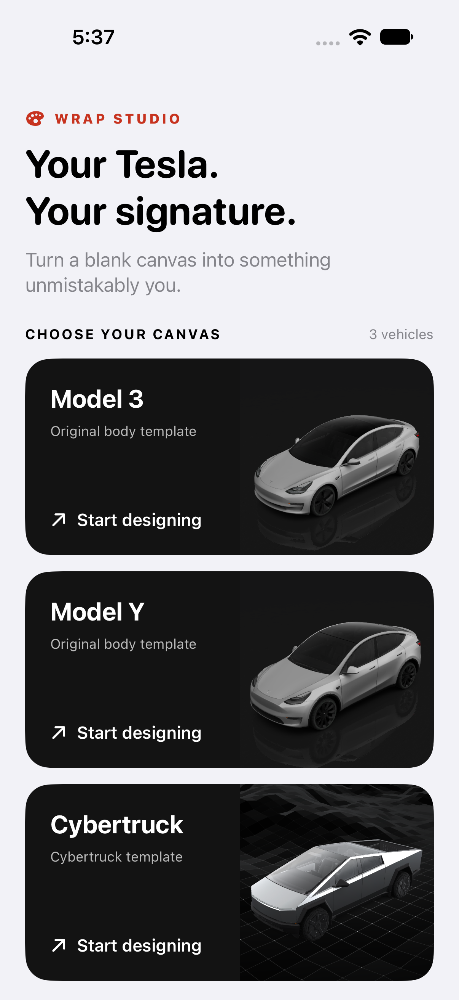

# Tesla Car Wrap · Wrap Studio

A native iPhone and iPad studio for painting custom textures for Tesla’s on-screen vehicle visualization. Pick a template, paint with your finger or Apple Pencil, add photo stickers, and export a PNG.

<p>
  
  
  
</p>

## What’s inside

- Separate Model 3, Model Y, and Cybertruck artwork and drafts.
- Pen, marker, eraser, ink colors, brush widths, and eight body fills.
- Photo stickers with drag, pinch, removal, and VoiceOver adjustment actions.
- One undo/redo history for paint, fill, stickers, and clearing a design.
- Atomic, debounced autosave, with an immediate save when leaving the editor or backgrounding the app.
- Device-independent template coordinates, so rotation and resizing keep artwork aligned.
- Real **Save to Files** and PNG sharing. Exports retain the template aspect ratio and stay under Tesla’s 1 MB limit, downsampling photo-heavy designs when necessary.
- Local storage; no account, analytics, server, or third-party packages.

The bundled Model 3 and Model Y artwork uses the **original body templates**. Newer body styles and trims need their matching templates and are not included. This app designs a 2D texture; it does not include a 3D preview or produce a physical vinyl-wrap pattern.

## Run

Requires Xcode with Swift 6 support and an iOS 17+ simulator or device. The checked-in Xcode project works without installing a project generator.

1. Open `Tesla Car Wrap.xcodeproj`.
2. Select the **Tesla Car Wrap** scheme and an iPhone or iPad simulator.
3. Run. For a physical device, choose your own development team under Signing & Capabilities.

`project.yml` is the project definition. If targets or source organization change, regenerate with [XcodeGen](https://github.com/yonaskolb/XcodeGen):

```sh
xcodegen generate
```

Signing identities and provisioning profiles are configured locally and are not stored in this repository.

## Test

```sh
xcodebuild test \
  -project "Tesla Car Wrap.xcodeproj" \
  -scheme "Tesla Car Wrap" \
  -destination 'platform=iOS Simulator,name=iPhone 18 Pro' \
  -parallel-testing-enabled NO \
  CODE_SIGNING_ALLOWED=NO
```

Substitute an installed simulator from `xcrun simctl list devices available`. Swift Testing covers vehicle artwork, coordinate transformations, draft migration, persistence, unified history, sticker import, and PNG rendering. XCTest exercises the native editor and export flow.

## Export to your Tesla

Save the PNG to Files, then use the Tesla app’s **Creations → Wrap → Upload**, or copy it into a **Wraps** folder at the root of a compatible USB drive. In the car, open **Toybox → Paint Shop → Wraps**. Check model/body-style compatibility first.

See [Tesla’s official templates and current requirements](https://github.com/teslamotors/custom-wraps) for setup and vehicle support. The exporter preserves the bundled template’s native resolution whenever its PNG fits within 1,000,000 bytes; otherwise it tries smaller resolutions with neither dimension below 512 pixels. It reports an error if the PNG still exceeds the limit.

## Drafts and privacy

Drafts live in `Documents/Wrap Studio Autosaves` as one versioned JSON document per vehicle. Each document contains PencilKit drawing data, sticker positions, and the selected fill. Imported photos live in `Documents/Stickers`. PNG share files are temporary. Nothing is uploaded by the app; sharing happens only when you choose an export destination.

The prototype’s `.wrapdata` and `.stickers` files are imported without deleting or rewriting the originals. Those files did not store their original canvas dimensions, so migration uses the first displayed canvas as a best-effort reference. New drafts always use template coordinates. A corrupt or unsupported draft is preserved, and the editor reports the problem instead of silently replacing it.

## Structure

| Folder | Responsibility |
| --- | --- |
| `Models` | Vehicle metadata and versioned design data |
| `Editor` | PencilKit bridge, coordinate mapping, history, and editing controls |
| `Stickers` | Photo import UI and gesture handling |
| `Storage` | Atomic drafts and downsampled photo library |
| `Export` | Masked composition, PNG validation, and Files document |

## Credits

Vehicle imagery, wrap templates, and derived masks/overlays were retained from the original app. The templates correspond to [Tesla’s custom-wraps project](https://github.com/teslamotors/custom-wraps). Tesla and its vehicle names are trademarks of Tesla, Inc. This is an independent project, not an official Tesla app. No rights to Tesla-owned assets are claimed.
