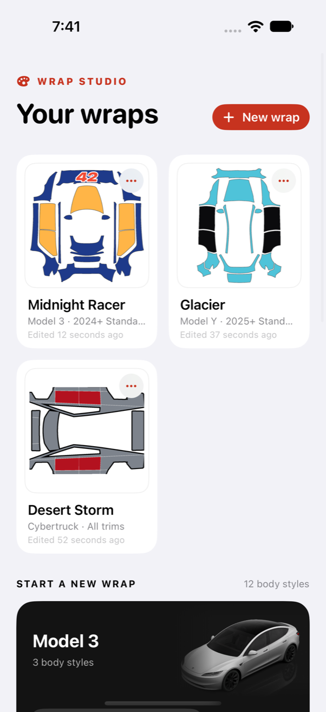
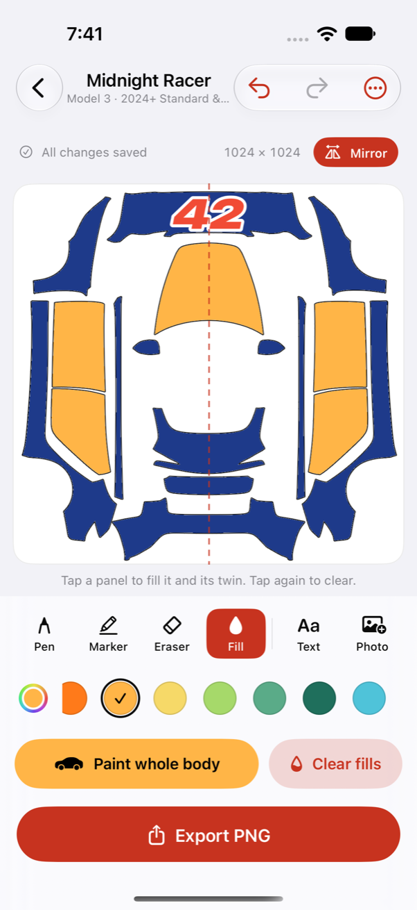
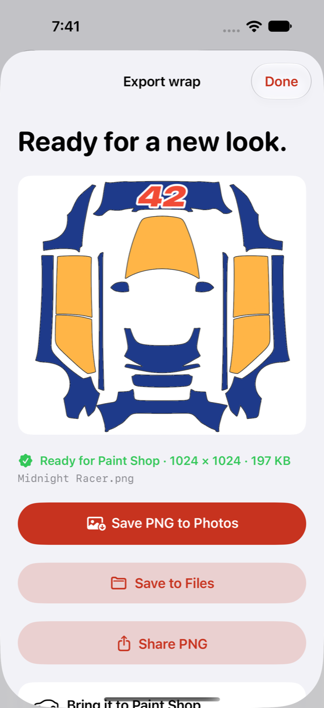

# Tesla Car Wrap · Wrap Studio

A native iPhone and iPad studio for designing custom textures for Tesla’s on-screen vehicle visualization (Toybox → Paint Shop → Wraps). Pick your body style, paint, fill panels, add photos and lettering, and export a PNG that is ready for Paint Shop.

<p>
  
  
  
</p>

## What’s inside

**Every current body style.** 12 official templates: Model 3 (2024+ Standard & Premium, 2024+ Performance, 2017–2023), Model Y (2025+ Standard, Premium and Performance, Model Y L, 2020–2024), Model S (2021+, 2025+ Plaid), Model X (2021+) and Cybertruck.

**A gallery of designs.** Keep any number of wraps per vehicle, each with a live thumbnail. Rename, duplicate or delete from a context menu. A new design that you leave without drawing anything is discarded automatically.

**Tools that understand a car.**
- Pen, marker and eraser with a size slider, plus a palette of 18 colors, a custom color picker and recent custom colors.
- **Fill** tool: tap a body panel to color just that panel, tap again to clear it, or paint the whole body at once.
- **Mirror**: strokes and panel fills are copied to the matching panel on the other side. Model 3/Y/S/X mirror left to right; Cybertruck mirrors top to bottom, the way Tesla lays out its templates.
- **Lettering**: names, numbers or slogans in four styles (Bold, Sport, Classic, Mono), with an optional contrasting outline.
- **Photo stickers**: drag, pinch and twist to place them. Rotate, flip, mirror to the other side, duplicate, bring to front or delete. New stickers start on the largest body panel, never on glass.
- One undo/redo history for every kind of edit.

**Built for every device.** Side-by-side layout in landscape and on iPad. Apple Pencil double-tap toggles the eraser, following the system setting. Hardware-keyboard shortcuts: ⌘Z / ⇧⌘Z undo and redo, P/M/E/F switch tools, T adds lettering, ⌘E exports. VoiceOver actions are available for moving, resizing, rotating, flipping and mirroring stickers.

**Export that just works.** The PNG keeps the template’s resolution and stays under Tesla’s 1 MB limit, downsampling photo-heavy designs if needed (never below 512 px). It is named after your design using only the characters Tesla accepts (letters, digits, spaces, `_` and `-`, up to 30 characters), so you see that name in Paint Shop. Save it to Photos with add-only permission (the original PNG bytes, no JPEG conversion), save it to Files, or share it.

Local storage only: no account, analytics, server or third-party packages.

## Run

Requires Xcode with Swift 6 support and an iOS 16+ device or iOS 17+ simulator for tests. The checked-in Xcode project works without a project generator.

1. Open `Tesla Car Wrap.xcodeproj`.
2. Select the **Tesla Car Wrap** scheme and an iPhone or iPad simulator.
3. Run. For a physical device, choose your own development team under Signing & Capabilities.

`project.yml` is the project definition. After adding, removing or moving source files or artwork, regenerate with [XcodeGen](https://github.com/yonaskolb/XcodeGen):

```sh
xcodegen generate
```

## Test

```sh
xcodebuild test \
  -project "Tesla Car Wrap.xcodeproj" \
  -scheme "Tesla Car Wrap" \
  -destination 'platform=iOS Simulator,name=iPhone 18 Pro' \
  -parallel-testing-enabled NO \
  CODE_SIGNING_ALLOWED=NO
```

Substitute an installed simulator from `xcrun simctl list devices available`. Swift Testing covers every vehicle’s artwork, panel detection and mirror symmetry, design storage and import, undo/redo, panel fills, mirrored strokes and stickers, sticker transforms, lettering, PNG rendering and file names, and Photos permission/write handling. The XCTest UI suite launches with `-resetLibrary` (debug builds only) to start from an empty gallery. It covers creating, exporting and reopening a design, discarding empty designs, mirrored panel fills, lettering, renaming, rotation and saving to Files and Photos.

The README screenshots come from `ScreenshotTests`, which builds three showcase designs. It is skipped unless enabled:

```sh
TEST_RUNNER_WRAP_SCREENSHOTS=1 xcodebuild test \
  -project "Tesla Car Wrap.xcodeproj" -scheme "Tesla Car Wrap" \
  -destination 'platform=iOS Simulator,name=iPhone 18 Pro' \
  -only-testing:WrapStudioUITests/ScreenshotTests \
  -resultBundlePath screenshots.xcresult CODE_SIGNING_ALLOWED=NO
xcrun xcresulttool export attachments --path screenshots.xcresult --output-path screenshots
```

## Export to your Tesla

Tap **Save PNG to Photos** and allow the app to add photos. In the Tesla app, open **Creations → Wrap → Upload** and choose the saved wrap. For USB transfer, use **Save to Files** and copy the PNG into a **Wraps** folder at the root of a compatible USB drive. In the car, open **Toybox → Paint Shop → Wraps**. Tesla shows up to 10 wraps from the app and 10 from USB. Pick the template that matches your vehicle’s body style.

See [Tesla’s official templates and current requirements](https://github.com/teslamotors/custom-wraps).

## Designs and privacy

Each design lives in its own folder, `Documents/Designs/<id>/`:

| File | Contents |
| --- | --- |
| `record.json` | Name, vehicle, created and modified dates |
| `design.json` | Versioned artwork: PencilKit drawing, body fill, panel fills, stickers |
| `thumbnail.png` | Gallery thumbnail, re-rendered whenever it is older than the artwork |

Panel fills are stored as a point inside the panel plus a color, so saved designs never depend on how panels happen to be numbered. Imported photos and lettering live in `Documents/Stickers` and are shared by all designs. PNG share files are temporary. Saving to Photos requests permission only to add images, never to read your library.

**Upgrading.** On first launch, version 1.3’s per-vehicle drafts (`Documents/Wrap Studio Autosaves/<vehicle>.wrap.json`) and the prototype’s `.wrapdata` / `.stickers` files become designs in the gallery. The original files are read but never modified or deleted. Empty drafts are skipped. A draft that can’t be read is still imported, and the editor explains the problem and refuses to overwrite it. Prototype drafts did not record their canvas size, so they are converted to template coordinates the first time the editor lays them out.

## Structure

| Folder | Responsibility |
| --- | --- |
| `Models` | Vehicles and families, mirror axes, versioned design data, design records |
| `Gallery` | Home screen, vehicle catalog, design library |
| `Editor` | Editor screen and controls, session and history, PencilKit bridge, panel map, coordinate mapping |
| `Stickers` | Photo import, lettering, on-canvas gestures |
| `Storage` | Per-design folders, legacy import, sticker library |
| `Export` | Composition, PNG validation and naming, Photos saving, Files document |
| `scripts/derive-artwork.swift` | Builds a vehicle’s mask and overlay from Tesla’s template |

## Adding a vehicle

1. Download `template.png` and `vehicle_image.png` from the vehicle’s folder in [teslamotors/custom-wraps](https://github.com/teslamotors/custom-wraps).
2. Generate the mask and overlay with `scripts/derive-artwork.swift`, and save all four files as `WrapStudio/Assets/<id>-template.png`, `-car.png`, `-mask.png` and `-overlay.png`.
3. Add a `Car` case whose raw value is `<id>`, with its family, trim and mirror axis. To find the axis, test which mirror sum (about twice the template’s centre) best maps the mask onto itself; `PanelMapTests` checks the result.
4. Run `xcodegen generate` and the tests.

## Credits

Vehicle imagery and wrap templates come from [Tesla’s custom-wraps project](https://github.com/teslamotors/custom-wraps); the masks and overlays are derived from them. Tesla and its vehicle names are trademarks of Tesla, Inc. This is an independent project, not an official Tesla app. No rights to Tesla-owned assets are claimed.
